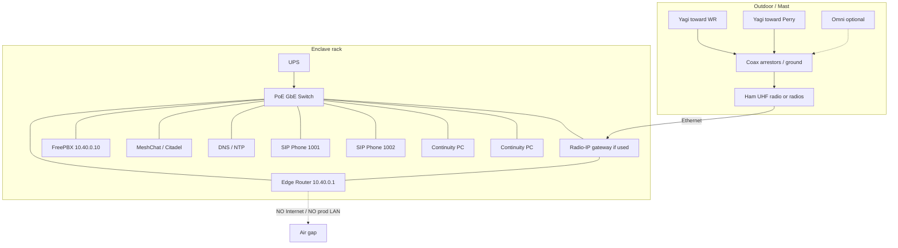

# EOC Kathleen — Equipment Wiring Diagram
## 102 Chief Williams Dr · Air-Gapped Hub

| Field | Value |
|-------|--------|
| Site | EOC Kathleen |
| Subnet | `10.40.0.0/24` (example) |
| Apps | FreePBX · MeshChat · Citadel |
| Related | [EOC Config](EOC_Node_Configuration.md) · [EOC BOM](EOC_Node_BOM.md) · [Overview](Mesh_Services_Overview.md) |

---

## 1. Block wiring (logical)

```text
                    OUTDOOR / MAST
     ┌──────────────────────────────────────────┐
     │  Yagi → Emory WR     Yagi → Emory Perry  │
     │         │                    │           │
     │         └────────┬───────────┘           │
     │                  │ coax + arrestors      │
     │         Optional omni (portables)        │
     │                  │                       │
     │         Ham 70 cm radio(s) 420–450 MHz   │
     └──────────────────┬───────────────────────┘
                        │ Ethernet and/or
                        │ radio–IP gateway
                        ▼
     ┌──────────────────────────────────────────┐
     │         ENCLAVE CLOSET / RACK            │
     │                                          │
     │   [UPS]──► PoE GbE Switch ◄── Edge Router│
     │              │    │    │         │       │
     │              │    │    │         │       │
     │              │    │    │    no WAN/Internet
     │              │    │    │         │       │
     │              │    │    └──── Radio/GW    │
     │              │    │                      │
     │              │    ├──── FreePBX mini PC  │
     │              │    │      10.40.0.10      │
     │              │    ├──── MeshChat/Citadel │
     │              │    │      (.11 / .12)     │
     │              │    └──── DNS/NTP (.13)    │
     │              │           (may share PC)  │
     │              ├──── SIP Phone 1001        │
     │              ├──── SIP Phone 1002        │
     │              ├──── Continuity PC A       │
     │              └──── Continuity PC B       │
     └──────────────────────────────────────────┘
```

---

## 2. Mermaid wiring diagram



---

## 3. Cable schedule

| From | To | Medium | Notes |
|------|----|--------|-------|
| Yagi WR | Radio RF port (or duplexer/switch per design) | Coax + arrestor | Aim Kathleen → Watson Blvd |
| Yagi Perry | Radio RF port | Coax + arrestor | Aim Kathleen → Morningside |
| Omni (opt.) | Radio / second radio | Coax | Portables only |
| Radio Ethernet or URI/gateway | PoE switch | Cat5e/6 | Enclave only |
| Edge router LAN | PoE switch | Cat5e/6 | Gateway `10.40.0.1` |
| Edge router RF/mesh iface | Gateway / radio subnet | Cat5e/6 | Route to `10.40.1.0/24`, `10.40.2.0/24` |
| FreePBX mini PC | PoE switch | Cat5e/6 | Static `10.40.0.10` |
| MeshChat/Citadel host | PoE switch | Cat5e/6 | Static `.11` / `.12` |
| SIP phone 1001 | PoE switch | Cat5e/6 PoE | DHCP |
| SIP phone 1002 | PoE switch | Cat5e/6 PoE | DHCP |
| Continuity PCs | PoE switch | Cat5e/6 | DHCP; MeshChat + Citadel |
| UPS | Switch, router, mini PCs, phones | AC | Enclave gear only |
| Building ground | Arrestors / rack ground bar | Ground wire | Bond once |

**Do not cable:** enclave switch uplink to county Internet edge, ISP modem, or any non-enclave LAN.

---

## 4. Power wiring

```text
Generator / building emergency circuit (if available)
        │
        ▼
   [UPS]
     ├── Edge router
     ├── PoE switch
     ├── FreePBX (+ MeshChat/Citadel) mini PC(s)
     ├── Radio PSUs (13.8 V)
     └── SIP phones (via PoE from switch)
```

---

## 5. Port map (example)

| Switch port | Device |
|------------:|--------|
| 1 | Edge router LAN |
| 2 | Radio / radio–IP gateway |
| 3 | FreePBX |
| 4 | MeshChat / Citadel |
| 5 | DNS/NTP (if separate) |
| 6 | SIP phone 1001 |
| 7 | SIP phone 1002 |
| 8 | Continuity PC A |
| 9 | Continuity PC B |
| 10+ | Spare / NMS |

Label every port **MESH ENCLAVE**.

---

## 6. Signal / service path summary

| Service | Path |
|---------|------|
| Voice | SIP phone → switch → router → RF → hospital phone (via FreePBX) |
| Chat | PC → switch → router → RF → MeshChat @ EOC (local PCs stay on switch) |
| Email | PC → switch → Citadel @ EOC |
| DHCP | Phones/PCs ← edge router |
| DNS/NTP | Clients → EOC `.13` |

---

*EOC equipment wiring — air-gapped hub*
