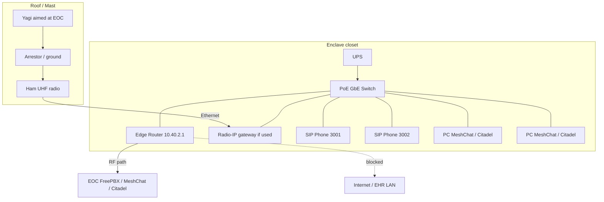

# Emory Perry — Equipment Wiring Diagram
## 1120 Morningside Dr · Air-Gapped Spoke

| Field | Value |
|-------|--------|
| Site | Emory Hospital Perry |
| Subnet | `10.40.2.0/24` (example) |
| FreePBX extensions | **3001**, **3002** |
| Hub services | FreePBX / MeshChat / Citadel @ EOC only |
| Related | [Hospital Config](Hospital_Node_Configuration.md) · [Perry BOM](Hospital_Perry_Node_BOM.md) · [Overview](Mesh_Services_Overview.md) |

---

## 1. Block wiring (logical)

```text
                 ROOF / MAST
     ┌─────────────────────────────────────┐
     │  Yagi ──────────────────────────────│─── aimed at EOC Kathleen
     │    │ coax + arrestor + ground       │
     │    ▼                                │
     │  Ham 70 cm radio 420–450 MHz        │
     └──────────────────┬──────────────────┘
                        │ Ethernet and/or
                        │ radio–IP gateway
                        ▼
     ┌─────────────────────────────────────┐
     │     ENCLAVE CLOSET (not EHR core)   │
     │                                     │
     │  [UPS]──► PoE GbE Switch            │
     │              │                      │
     │              ├── Edge Router        │
     │              │    10.40.2.1         │
     │              │    DHCP for phones/PCs
     │              │    route → 10.40.0.0/24 via RF
     │              │    NO Internet / NO EHR
     │              ├── Radio / gateway    │
     │              ├── SIP Phone 3001     │
     │              ├── SIP Phone 3002     │
     │              ├── Continuity PC A    │
     │              │     MeshChat+Citadel │
     │              └── Continuity PC B    │
     └─────────────────────────────────────┘

     Optional Phase D (dashed): 2nd Yagi + radio toward Warner Robins
```

---

## 2. Mermaid wiring diagram



---

## 3. Cable schedule

| From | To | Medium | Notes |
|------|----|--------|-------|
| Yagi | Radio RF port | Coax + arrestor | Bore-sight EOC |
| Radio Ethernet or URI/gateway | PoE switch | Cat5e/6 | Enclave only |
| Edge router LAN | PoE switch | Cat5e/6 | `10.40.2.1` |
| Edge router RF iface | Gateway / radio | Cat5e/6 | Toward EOC |
| SIP phone 3001 | PoE switch | Cat5e/6 PoE | DHCP; SIP → `10.40.0.10` |
| SIP phone 3002 | PoE switch | Cat5e/6 PoE | DHCP; SIP → `10.40.0.10` |
| Continuity PCs | PoE switch | Cat5e/6 | MeshChat `.11`, Citadel `.12` |
| UPS | Switch, router, radio PSU | AC | |
| Building ground | Arrestor / rack | Ground | Bond to building steel per Facilities |

**Forbidden:** patch from enclave switch to hospital core, EHR, guest Wi‑Fi, or ISP.

---

## 4. Power wiring

```text
Building / emergency outlet (Facilities-approved)
        │
        ▼
   [UPS]
     ├── Edge router
     ├── PoE switch
     ├── Radio power supply
     └── SIP phones (PoE from switch)
```

---

## 5. Port map (example)

| Switch port | Device |
|------------:|--------|
| 1 | Edge router LAN |
| 2 | Radio / radio–IP gateway |
| 3 | SIP phone 3001 |
| 4 | SIP phone 3002 |
| 5 | Continuity PC A |
| 6 | Continuity PC B |
| 7+ | Spare |

Label every port **MESH ENCLAVE — NOT EHR**.

---

## 6. Service paths from this site

| Service | Wiring / path |
|---------|----------------|
| Voice | Phone 3001/3002 → switch → router → RF → **FreePBX @ EOC** → far phone |
| Chat | PC → switch → router → RF → **MeshChat @ EOC** |
| Email | PC → switch → router → RF → **Citadel @ EOC** |
| DHCP / GW | Edge router `10.40.2.1` |
| DNS / NTP | Via RF to EOC `10.40.0.13` |

**No app servers are wired at this hospital** — clients only.

---

## 7. Optional backup hop (Phase D)

```text
2nd Yagi ──coax── 2nd radio ──Eth── same PoE switch
                         │
                         └── router secondary route to 10.40.1.0/24
```

Only if authorized; prefer EOC hub for voice.

---

*Emory Perry equipment wiring — air-gapped spoke*
